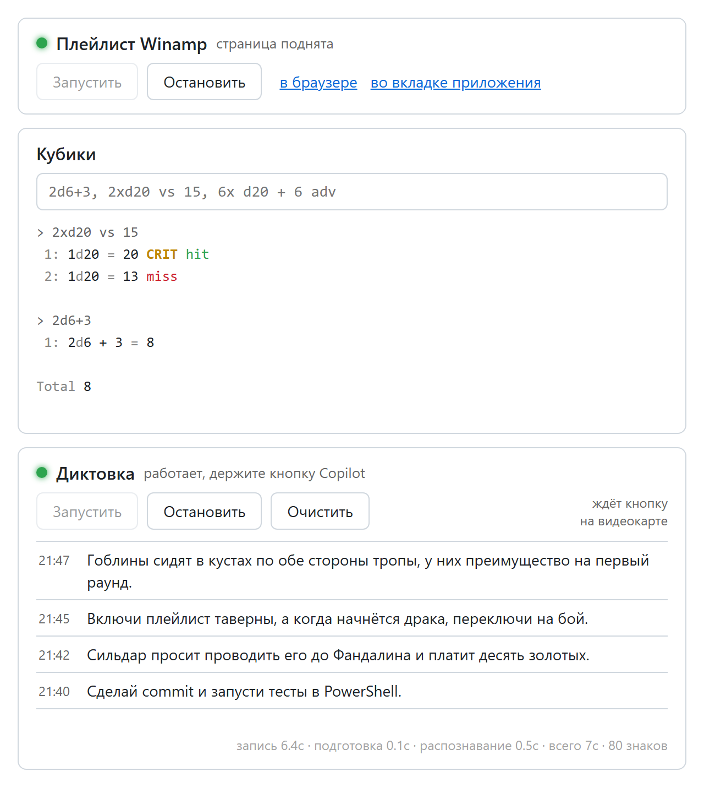
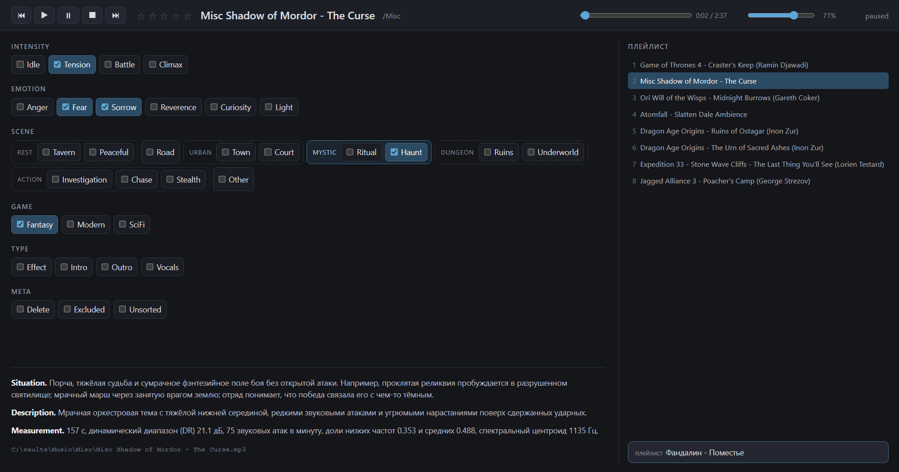

# Roll

PowerShell-модуль ведущего настольных ролевых игр: музыка к сессиям и плейлисты Winamp, голосовая диктовка, броски кубиков, загрузка книг на reMarkable и пульт для GitHub Copilot, на котором всё это собрано кнопками.



## Что внутри

- **Пульт** (`Install-RollPanel`) - canvas для приложения GitHub Copilot: запускает и останавливает диктовку и страницу плейлиста, показывает журнал распознанных фраз и бросает кубики. Подробности в [Tools/Panel/README.md](Tools/Panel/README.md).
- **Диктовка** (`Start-Dictation`, `Stop-Dictation`) - держишь кнопку Copilot на клавиатуре, говоришь, отпускаешь, и текст печатается в позицию курсора. Распознаёт локальная faster-whisper (large-v3-turbo), русский вперемешку с английским. Кодировщик модели считается в OpenVINO на встроенной видеокарте Intel, поэтому фраза в 10-20 секунд распознаётся меньше чем за секунду. Без видеокарты всё работает на процессоре, `Start-Dictation -Encoder off`.
- **Кубики** (`Invoke-DiceRoll`, псевдоним `roll`) - выражения вида `2d6+3`, `2xd20 vs 15`, `6x d20 + 6 adv` с подсветкой критов и промахов.
- **Музыка** (`Update-MusicLibrary`, `Get-Track`, `Set-Track`, `Save-YouTubePlaylist`, `Split-YouTubeVideoByChapter`) - библиотека треков с тегами сцен в `Tracks.csv`, загрузка с YouTube и нарезка по главам.
- **Плейлисты** (`Export-Playlist`, `Import-WinampPlaylist`, `Sync-WinampPlaylist`, `Start-WinampPlaylist`) - плейлисты сцен живут в файлах кампании. Модуль выгружает их в `.m3u8` и в Winamp, переносит правки из медиатеки Winamp обратно и поднимает локальную страницу, которая показывает и переключает текущий плейлист. На ней же правятся теги играющего трека.

  
- **reMarkable** (`Send-Remarkable`, `Get-RemarkableDocument`, `New-RemarkableCollection`) - загрузка PDF, EPUB и Markdown на планшет по Wi-Fi и просмотр его папок.
- **Картинки** (`Get-PngPrompt`, `Get-ExeIcon`) - промпт и workflow ComfyUI из сгенерированного PNG, иконка из exe.

Полный список команд - `Get-Command -Module Roll`, справка к каждой - `Get-Help <команда> -Full`.

## Установка

```powershell
git clone https://github.com/FallenGameR/Roll
Import-Module .\Roll\Roll.psd1
```

Что понадобится по темам:

- PowerShell 7 для всего модуля;
- для диктовки - Python 3.9 (`py -3.9`) и один раз `Install-Dictation`: он соберёт venv в `%LOCALAPPDATA%\Roll\dictation`. Модели скачаются из Hugging Face при первом запуске, около 2 ГБ;
- для музыки - ffmpeg и yt-dlp (`winget install Gyan.FFmpeg yt-dlp.yt-dlp`);
- для плейлистов - Winamp и Python с пакетом `mutagen`;
- для reMarkable - [RCU](http://www.davisr.me/projects/rcu/) с настроенным пресетом подключения;
- для пульта - приложение GitHub Copilot и один раз `Install-RollPanel`.

Музыка и кампания ищутся в `C:\vaults`, пути к самому модулю находятся относительно его файлов.

## Устройство

- `Public\<Тема>` - команды, одна функция на файл.
- `Private\<Тема>` - помощники, которые зовут только команды модуля.
- `Tools\<Тема>` - самостоятельные скрипты на Python, PowerShell и JS: диктовка, пульт, страница Winamp, обработка звука и карт.
- `Tools\OneOff` - разовые скрипты миграций, оставленные как запись того, что и как меняли.
